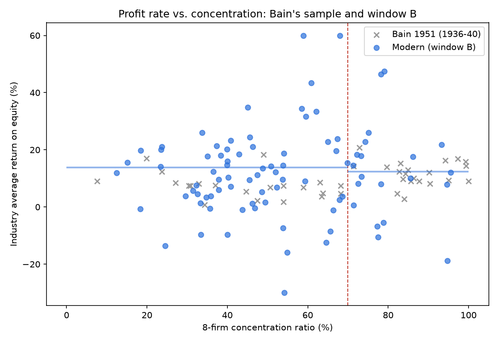
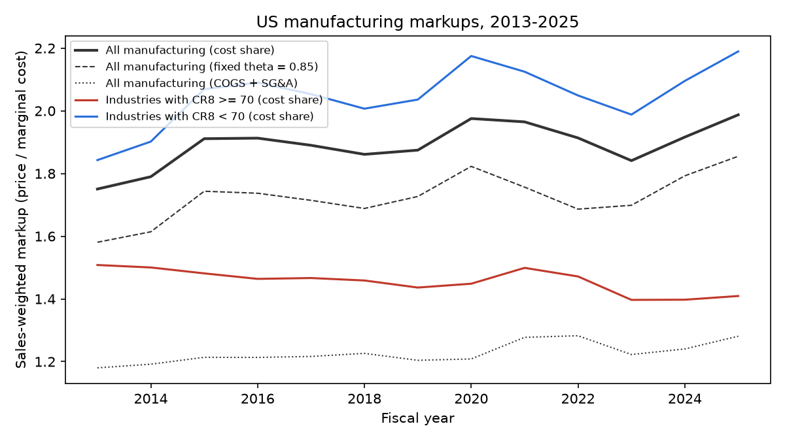
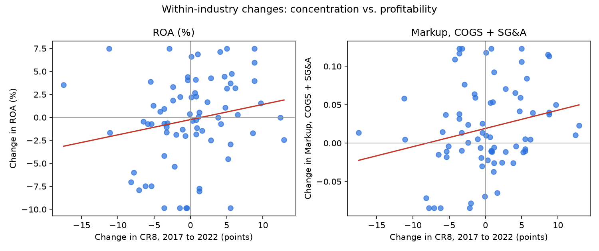

# Do industries run by a few giants make more money?

### Revisiting Joe Bain's 1951 study of American manufacturing, with data from 2015–2025

In 1951, economist Joe Bain asked a simple question: **when a handful of companies dominate an industry, do they
earn bigger profits?** He looked at 42 American manufacturing industries from 1936 to 1940, from cigarettes and
typewriters to cement and shoes, and found a clear answer: yes. Industries where the eight biggest companies made
70% or more of all sales earned about **12% a year** on shareholders' money. Everyone else earned about **7%**.

That finding shaped antitrust thinking for decades: if concentration means profits, concentration means market
power. This project asks whether it's still true. It uses every US manufacturing industry in the 2017 and 2022
Economic Census, and the financial results of about 1,000 publicly traded manufacturers.

---

## The short answer

1. **Bain's pattern is gone.** Today, industries dominated by a few giants don't earn more than other industries.
2. **The thing that looks like extra pricing power is mostly R&D.** Drug makers and chip makers look like they
   charge the biggest markups, but that's because their research spending isn't counted as a cost of making the
   product. Count it, and concentrated industries look no different.
3. **But when an industry *becomes* more concentrated, its biggest companies do get more profitable**, while
   smaller rivals fall behind. That looks more like the strongest companies pulling ahead than like companies
   teaming up to raise prices.

---

## A few terms, in plain English

- **Concentration:** the share of an industry's sales made by its 8 biggest companies (economists call it
  **CR8**). Breakfast cereal is highly concentrated: General Mills, Kellogg's successors (Kellanova and WK
  Kellogg) and a few others make 93% of it. Plastic products are the opposite: the top 8 make about 13%. Bain's
  dividing line was 70%.
- **Return on equity (ROE):** profit as a share of the money shareholders have put in. This was Bain's measure.
- **Return on assets (ROA):** profit as a share of everything the company owns. It's harder to distort, so it's
  the main measure here (see below for why).
- **Markup:** how far a company's prices sit above what it costs to make one more unit. A markup of 1.5 means
  prices are 50% above that cost.

---

## Finding 1: Dominating an industry no longer means bigger profits

| | Industries | Highly concentrated (CR8 ≥ 70%) | Everyone else |
|---|---|---|---|
| **Bain, 1936–40** (return on equity) | 42 | **12.1%** | **6.9%** |
| **2015–19** (return on assets) | 103 | 5.7% | 5.3% |
| **2021–25** (return on assets) | 88 | 5.6% | 5.1% |

In Bain's data, the gap was large and almost certainly not luck. Today it's half a percentage point and
statistically indistinguishable from zero. Moving the line doesn't rescue it either: trying every cutoff from 25%
to 85% turns up no dividing line that holds in both periods.

**Concentrated industries are all over the map:**

| Industry | Biggest companies | Top-8 share | Profit (ROA), 2021–25 |
|---|---|---|---|
| Chip-making equipment | Applied Materials, Lam Research | 78% | **21%** |
| Tobacco | Philip Morris, Altria | 96% | **17%** |
| Aircraft | Boeing | 95% | **−3%** (losses) |
| Batteries | EnerSys, Energizer, Fluence | 79% | **−5%** (losses) |

**And some less concentrated industries do very well:**

| Industry | Biggest companies | Top-8 share | Profit, 2021–25 |
|---|---|---|---|
| Soft drinks | PepsiCo, Coca-Cola, Monster | 61% | ROE 43% |
| Medical devices | Abbott, Boston Scientific, Intuitive Surgical | 40% | ROA 8% |



*Each blue dot is a modern industry (2021–25). Grey crosses are Bain's 1930s industries. If Bain's pattern held,
the dots right of the red line would sit higher. They don't.*

**Why not just use Bain's measure (ROE)?** Because share buybacks and big losses have wiped out shareholder equity
at some of the best-known companies. Philip Morris International and Boeing have both reported negative
shareholders' equity in recent years. When equity is near zero or below, "profit ÷ equity" stops meaning anything.
ROE gives the same answer in this study, but ROA is the more trustworthy number.

---

## Finding 2: The "high markup" industries are really the high-R&D industries

Economists today often measure market power with **markups** rather than profits, following an influential 2020
study by De Loecker, Eeckhout and Unger. The standard version compares a company's revenue with its **cost of
goods sold**: materials, factory wages and the like.

Measured that way, concentrated industries actually have *lower* markups. The reason is what cost of goods sold
leaves out. Research, marketing and overhead don't count. So companies like **Pfizer, Merck, AbbVie and Amgen**,
whose biggest expenses are research and marketing, look as if they charge enormous markups. These industries
happen to be only moderately concentrated, so they pull the "everyone else" average up.

Once research, marketing and overhead count as costs too (a fix proposed by economist James Traina), **the gap
disappears**: markups are about 1.2 in both groups.



*Manufacturing markups rose from 1.75 to 1.99 between 2013 and 2025 (solid black line). All of the rise came from
the less concentrated group (blue), which includes pharmaceuticals, biotech, chips and medical devices. Markups in
the most concentrated industries (red) slipped.*

---

## Finding 3: When an industry consolidates, its biggest companies pull ahead

Comparing different industries can mislead, because a drug maker and a steel mill differ in a hundred ways. So
the last test compares **each industry with itself**: did profits rise in industries that became more
concentrated between the 2017 and 2022 Censuses?

**On average, yes**, especially in large industries. For example:

| Industry | Biggest companies | Change in top-8 share | ROA before → after |
|---|---|---|---|
| Steel mills | Nucor, Cleveland-Cliffs, Steel Dynamics, U.S. Steel | +4 points | 3.8% → 10.9% |
| Oil refining | ExxonMobil, Chevron, Marathon, Valero, Phillips 66 | +5 points | 4.2% → 8.6% |
| Semiconductors | Nvidia, Intel, Qualcomm, Broadcom | +5 points | 9.9% → 13.1% |
| Railcars | Wabtec, Greenbrier | +13 points | 6.5% → 4.0% |

The railcar row shows it isn't automatic. And the first two rows come with an important caveat: steel and refining
also had huge price booms in 2021–22, after the pandemic and Russia's invasion of Ukraine. Some of that profit
jump would have happened anyway. (Steel's concentration rose partly because Cleveland-Cliffs bought AK Steel and
ArcelorMittal USA in 2020.) The overall result holds even with refining left out, though.

**The key detail is who gained.** Looking at the same ~560 companies in both periods: when an industry became
more concentrated, **its largest companies' profits rose, while smaller companies' profits fell**. If the big
companies were simply coordinating to raise prices, the small ones would benefit too. Instead this matches what
economists call the **"superstar firm"** story: the strongest companies win market share *and* earn more, and
everyone else falls further behind.



*Each dot is an industry. Moving right means it became more concentrated. Moving up means profits (left) or
markups (right) rose.*

---

## What this does and doesn't mean

**It does mean:** the simple rule "concentrated industry = high profits," which guided antitrust for a
generation, doesn't describe American manufacturing today.

**It doesn't mean market power has disappeared.** A few things make this kind of test harder than it was in 1951:

- **Profits are global, concentration is local.** The concentration numbers cover factories in the US, but
  companies like Apple and Pfizer report worldwide profits.
- **Imports aren't counted.** US car production looks highly concentrated, but American buyers also have Toyota,
  Hyundai, BMW and others to choose from. (The code can adjust for this with a free Census API key. It hasn't been
  run yet.)
- **Accounting misses intangibles.** Brands, patents and software rarely appear as assets on the balance sheet,
  which flatters returns for some industries more than others.
- **Only public companies.** Private manufacturers, especially small ones, aren't in the data.
- **Finding 3 is a pattern, not proof of cause.** Mergers, booms and busts can move concentration and profits at
  the same time.

---

## For economists: details and reproduction

- **[results/FINDINGS.md](results/FINDINGS.md):** full write-up with test statistics, the Demsetz test,
  regressions with entry-barrier controls, and the markup methods.
- **[results/REPORT.md](results/REPORT.md)** and **[results/CHANGES.md](results/CHANGES.md):** every table.

**Method in brief:** 8-firm concentration ratios for 6-digit NAICS industries from the 2017 and 2022 Economic
Census, matched to Compustat profits for US-headquartered firms over five-year windows (FY2015–19, FY2021–25).
Bain's sample rules are applied up front: industries need data for at least 3 firms, firms must earn two-thirds of
sales in one industry, and local-market industries are dropped. Firms also need $10M+ in average sales. Industry
averages weight firms by size within each year, then average across years, as Bain did. Markups are
θ × sales / costs, with θ from industry cost shares. A production-function estimate of θ was tested and dropped
because it couldn't recover a known θ on simulated data.

### Reproducing it

1. **Get the Compustat data.** It's licensed through WRDS, so it isn't included here. Pull the two extracts in
   [DATA_TO_GET.md](DATA_TO_GET.md) and save them in `data/compustat/`.
2. **Install the packages** (Python 3.12+):

   ```bash
   pip install -r requirements.txt
   ```

3. **Run:**

   ```bash
   python src/bain_modern.py --compustat data/compustat/funda_2013_2026.csv.zip --segments data/compustat/segments_hist_2014_2026.csv.zip
   python src/concentration_changes.py
   ```

| Path | What it is |
|---|---|
| [src/bain_modern.py](src/bain_modern.py) | Builds the samples and runs every cross-industry test and the markups |
| [src/concentration_changes.py](src/concentration_changes.py) | The within-industry test (Finding 3) |
| `results/` | Write-up, tables, industry-level results and charts |
| `data/raw/` | Census concentration ratios (2017, 2022) and the NAICS 2017↔2022 concordance |

### Data sources

- **US Census Bureau:** 2017 and 2022 Economic Census concentration tables, and NAICS concordances. Public domain.
- **Compustat** (North America Fundamentals Annual and Historical Segments) via Wharton Research Data Services.
  Licensed, not redistributed here. Only industry-level aggregates appear in `results/`.
- **The original study:** Joe S. Bain, "Relation of Profit Rate to Industry Concentration: American Manufacturing,
  1936–1940," *Quarterly Journal of Economics* 65(3), 1951, pp. 293–324.
