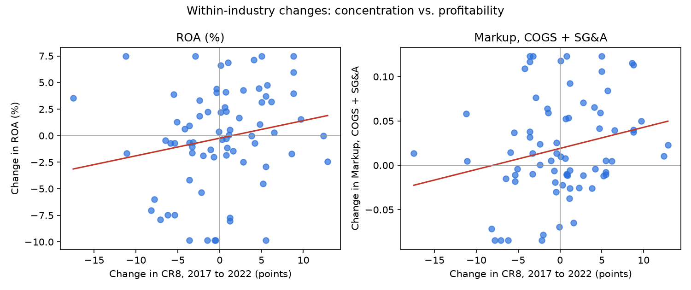

# Concentration changes vs. profit and markup changes

Each industry compared with itself: CR8 from the 2017 to the 2022 Economic Census, against profit rates and markups from FY2015–19 to FY2021–25. Only industries whose NAICS definition didn't change.

## How concentration changed, all manufacturing

Across 330 manufacturing industries with unchanged definitions, CR8 changed by +0.4 points on average (+0.4 weighted by shipments). It rose in 56% of industries. Median change +0.6; 10th–90th percentile -5.9 to +6.2.

Largest increases:

|   naics | label                                                                                          |   cr8 |   cr8_22 |   d_cr8 |
|--------:|:-----------------------------------------------------------------------------------------------|------:|---------:|--------:|
|  321912 | Cut stock, resawing lumber, and planing                                                        |  32   |     47.1 |    15.1 |
|  311411 | Frozen fruit, juice, and vegetable manufacturing                                               |  57   |     71.2 |    14.2 |
|  335122 | Commercial, industrial, and institutional electric lighting fixture manufacturing              |  34.9 |     48.8 |    13.9 |
|  336510 | Railroad rolling stock manufacturing                                                           |  59.6 |     72.5 |    12.9 |
|  325311 | Nitrogenous fertilizer manufacturing                                                           |  76.7 |     89.4 |    12.7 |
|  334310 | Audio and video equipment manufacturing                                                        |  41.4 |     53.8 |    12.4 |
|  332812 | Metal coating, engraving (except jewelry and silverware), and allied services to manufacturers |  33.4 |     45.7 |    12.3 |
|  332811 | Metal heat treating                                                                            |  39.9 |     51.3 |    11.4 |

Largest decreases:

|   naics | label                                                   |   cr8 |   cr8_22 |   d_cr8 |
|--------:|:--------------------------------------------------------|------:|---------:|--------:|
|  334290 | Other communications equipment manufacturing            |  52.3 |     34.8 |   -17.5 |
|  336991 | Motorcycle, bicycle, and parts manufacturing            |  87.1 |     69.9 |   -17.2 |
|  311821 | Cookie and cracker manufacturing                        |  68.7 |     55.7 |   -13   |
|  311340 | Nonchocolate confectionery manufacturing                |  57.6 |     44.6 |   -13   |
|  311920 | Coffee and tea manufacturing                            |  66.1 |     54.2 |   -11.9 |
|  315990 | Apparel accessories and other apparel manufacturing     |  39.2 |     27.6 |   -11.6 |
|  333132 | Oil and gas field machinery and equipment manufacturing |  52   |     40.8 |   -11.2 |
|  333131 | Mining machinery and equipment manufacturing            |  53.5 |     42.4 |   -11.1 |

## Industry level (74 industries in both samples)

Slope = change in the measure per 1-point rise in CR8. Robust standard errors.

| Measure | Mean change | Slope | SE | p | Slope, shipment-weighted | p |
|---|---|---|---|---|---|---|
| ROE (%) | +0.887 (median) | +0.4638 | 0.2765 | 0.093 | +1.1247 | 0.003 |
| ROA (%) | -0.013 (median) | +0.1655 | 0.1067 | 0.121 | +0.4364 | 0.001 |
| Operating ROA (%) | -0.464 (median) | +0.1678 | 0.1105 | 0.129 | +0.5234 | 0.014 |
| Price-cost margin (%) | +0.555 (median) | +0.1517 | 0.0706 | 0.032 | +0.1969 | 0.098 |
| Markup, COGS (cost share) | +0.003 (median) | +0.0049 | 0.0038 | 0.195 | +0.0080 | 0.066 |
| Markup, COGS + SG&A | +0.010 (median) | +0.0024 | 0.0011 | 0.024 | +0.0026 | 0.224 |

Industry changes are winsorized at 5%/95% because the sample is small.

**Robustness (shipment-weighted ROA slope):** the largest industry, petroleum refineries, carries 23% of the weight. Without it the slope is +0.305 (p = 0.027). Dropping any single industry leaves it between +0.305 and +0.475.

## Firm level (564 firms in the same industry in both periods)

Same firms in both periods, so changes in which firms are listed don't matter. Standard errors clustered by industry.

| Measure | Slope (all firms) | p | Slope, smaller firms | p | Extra slope, largest quartile | p |
|---|---|---|---|---|---|---|
| ROE (%) | +1.4857 | 0.106 | +2.0679 | 0.068 | -1.2836 | 0.325 |
| ROA (%) | -0.7130 | 0.074 | -0.8128 | 0.068 | +0.9674 | 0.044 |
| Operating ROA (%) | -0.6667 | 0.078 | -0.7819 | 0.065 | +0.9607 | 0.043 |
| Markup, COGS (cost share) | -0.0085 | 0.397 | -0.0164 | 0.213 | +0.0517 | 0.090 |
| Markup, COGS + SG&A | -0.0036 | 0.095 | -0.0050 | 0.056 | +0.0079 | 0.115 |

If rising concentration made collusion easier, small firms' profits should rise along with large firms'. If it reflected efficient firms winning share, only the large firms should gain.

