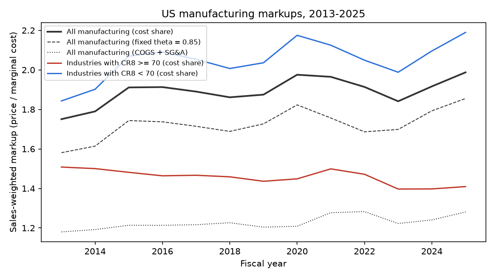
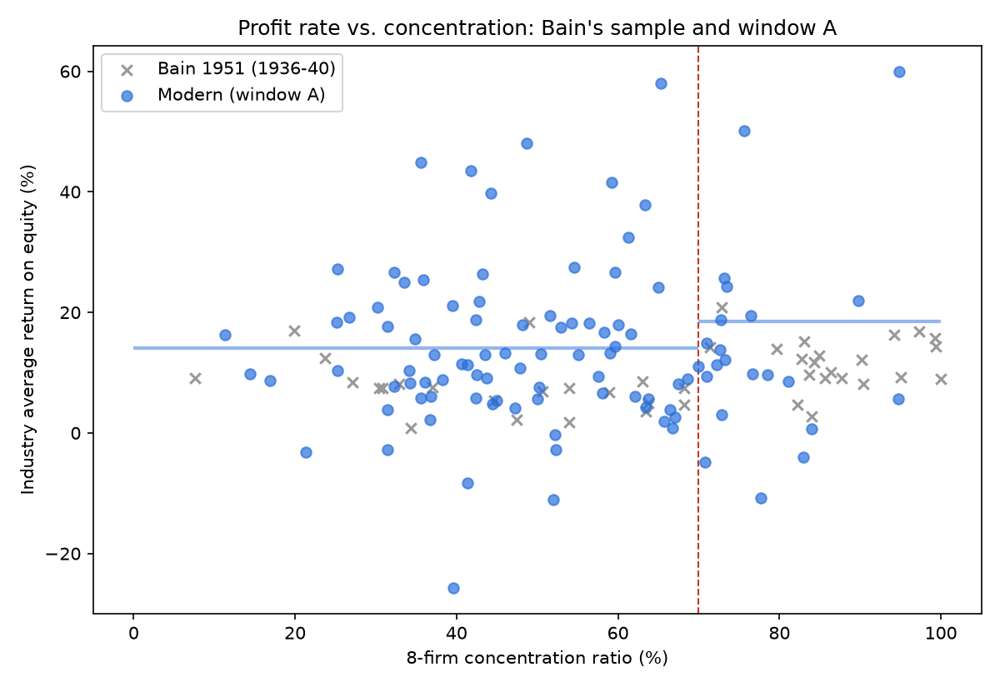
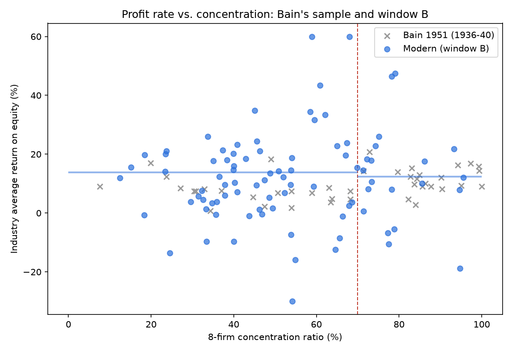
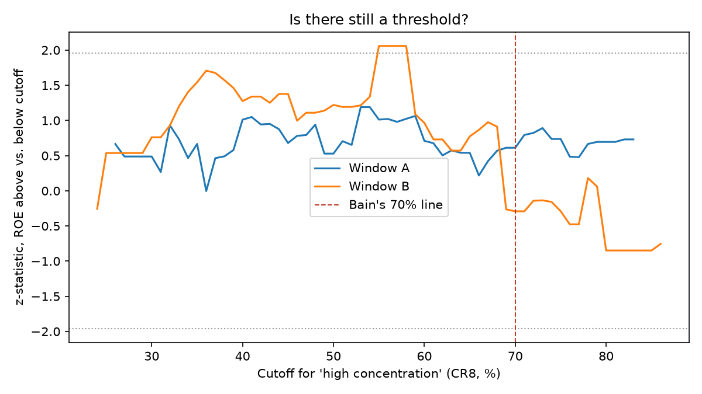

# Bain (1951) on modern data: results

## Markup trend, US manufacturing (sales-weighted)

Industries split by 2017 concentration. Markup = theta x sales / COGS (De Loecker, Eeckhout & Unger 2020).

|   year |   firms |   all, cost share |   all, fixed theta |   all, COGS+SG&A |   CR8 >= 70 |   CR8 < 70 |
|-------:|--------:|------------------:|-------------------:|-----------------:|------------:|-----------:|
|   2013 |    1407 |             1.751 |              1.581 |            1.18  |       1.508 |      1.843 |
|   2014 |    1364 |             1.79  |              1.614 |            1.192 |       1.5   |      1.902 |
|   2015 |    1320 |             1.911 |              1.744 |            1.214 |       1.481 |      2.069 |
|   2016 |    1257 |             1.913 |              1.737 |            1.213 |       1.464 |      2.09  |
|   2017 |    1239 |             1.89  |              1.714 |            1.216 |       1.467 |      2.053 |
|   2018 |    1246 |             1.861 |              1.689 |            1.226 |       1.459 |      2.007 |
|   2019 |    1239 |             1.875 |              1.727 |            1.204 |       1.436 |      2.036 |
|   2020 |    1226 |             1.975 |              1.823 |            1.208 |       1.448 |      2.175 |
|   2021 |    1272 |             1.965 |              1.757 |            1.277 |       1.499 |      2.125 |
|   2022 |    1195 |             1.914 |              1.686 |            1.283 |       1.472 |      2.049 |
|   2023 |    1127 |             1.841 |              1.699 |            1.223 |       1.397 |      1.988 |
|   2024 |    1073 |             1.916 |              1.793 |            1.24  |       1.397 |      2.095 |
|   2025 |    1015 |             1.987 |              1.855 |            1.281 |       1.409 |      2.19  |

Cost-share theta (median COGS / (COGS + rK)) by 3-digit subsector and year:

|   sub3 |    2012 |   2013 |   2014 |   2015 |   2016 |   2017 |   2018 |   2019 |   2020 |   2021 |   2022 |   2023 |   2024 |   2025 |   2026 |
|-------:|--------:|-------:|-------:|-------:|-------:|-------:|-------:|-------:|-------:|-------:|-------:|-------:|-------:|-------:|-------:|
|    311 |   0.958 |  0.939 |  0.934 |  0.935 |  0.935 |  0.93  |  0.93  |  0.928 |  0.931 |  0.956 |  0.966 |  0.923 |  0.896 |  0.904 |    nan |
|    312 |   0.891 |  0.903 |  0.921 |  0.921 |  0.93  |  0.93  |  0.912 |  0.917 |  0.91  |  0.944 |  0.962 |  0.911 |  0.904 |  0.903 |    nan |
|    313 |   0.979 |  0.955 |  0.961 |  0.951 |  0.95  |  0.951 |  0.946 |  0.933 |  0.913 |  0.949 |  0.951 |  0.878 |  0.87  |  0.884 |    nan |
|    314 | nan     |  0.917 |  0.922 |  0.91  |  0.912 |  0.912 |  0.891 |  0.877 |  0.861 |  0.913 |  0.943 |  0.868 |  0.854 |  0.855 |    nan |
|    315 |   0.948 |  0.962 |  0.967 |  0.961 |  0.966 |  0.954 |  0.956 |  0.928 |  0.918 |  0.984 |  0.987 |  0.957 |  0.937 |  0.893 |    nan |
|    316 |   0.962 |  0.964 |  0.96  |  0.952 |  0.953 |  0.953 |  0.948 |  0.928 |  0.941 |  0.968 |  0.975 |  0.942 |  0.93  |  0.931 |    nan |
|    321 |   0.972 |  0.956 |  0.951 |  0.95  |  0.941 |  0.954 |  0.974 |  0.967 |  0.945 |  0.964 |  0.975 |  0.929 |  0.952 |  0.948 |    nan |
|    322 |   0.945 |  0.879 |  0.894 |  0.871 |  0.877 |  0.877 |  0.879 |  0.856 |  0.865 |  0.916 |  0.928 |  0.84  |  0.813 |  0.811 |    nan |
|    323 |   0.942 |  0.935 |  0.936 |  0.928 |  0.921 |  0.918 |  0.921 |  0.915 |  0.911 |  0.94  |  0.937 |  0.895 |  0.853 |  0.853 |    nan |
|    324 |   0.17  |  0.968 |  0.966 |  0.942 |  0.935 |  0.941 |  0.936 |  0.929 |  0.912 |  0.962 |  0.978 |  0.945 |  0.931 |  0.927 |    nan |
|    325 |   0.946 |  0.943 |  0.945 |  0.936 |  0.947 |  0.947 |  0.951 |  0.937 |  0.936 |  0.959 |  0.968 |  0.928 |  0.915 |  0.918 |    nan |
|    326 |   0.919 |  0.912 |  0.918 |  0.895 |  0.894 |  0.899 |  0.893 |  0.877 |  0.874 |  0.926 |  0.936 |  0.847 |  0.828 |  0.834 |    nan |
|    327 |   0.734 |  0.891 |  0.892 |  0.882 |  0.886 |  0.877 |  0.871 |  0.868 |  0.861 |  0.905 |  0.933 |  0.846 |  0.835 |  0.811 |    nan |
|    331 |   0.953 |  0.935 |  0.932 |  0.904 |  0.901 |  0.918 |  0.901 |  0.901 |  0.887 |  0.931 |  0.955 |  0.886 |  0.874 |  0.88  |    nan |
|    332 |   0.945 |  0.934 |  0.929 |  0.918 |  0.924 |  0.923 |  0.922 |  0.907 |  0.911 |  0.948 |  0.961 |  0.907 |  0.884 |  0.889 |    nan |
|    333 |   0.959 |  0.942 |  0.944 |  0.933 |  0.933 |  0.936 |  0.94  |  0.926 |  0.926 |  0.953 |  0.967 |  0.925 |  0.909 |  0.914 |    nan |
|    334 |   0.938 |  0.935 |  0.935 |  0.928 |  0.932 |  0.932 |  0.934 |  0.911 |  0.912 |  0.943 |  0.959 |  0.917 |  0.902 |  0.905 |    nan |
|    335 |   0.927 |  0.941 |  0.946 |  0.936 |  0.934 |  0.936 |  0.94  |  0.932 |  0.929 |  0.958 |  0.97  |  0.932 |  0.916 |  0.92  |    nan |
|    336 |   0.95  |  0.956 |  0.955 |  0.947 |  0.948 |  0.947 |  0.945 |  0.937 |  0.933 |  0.955 |  0.965 |  0.922 |  0.921 |  0.925 |    nan |
|    337 |   0.935 |  0.939 |  0.943 |  0.934 |  0.934 |  0.938 |  0.936 |  0.923 |  0.926 |  0.955 |  0.961 |  0.902 |  0.891 |  0.859 |    nan |
|    339 |   0.932 |  0.92  |  0.93  |  0.916 |  0.914 |  0.917 |  0.906 |  0.891 |  0.89  |  0.926 |  0.941 |  0.88  |  0.886 |  0.891 |    nan |

## Window A: 2017 concentration, FY2015–2019

103 industries, 992 firms.

### Bain's test: above vs. below 70% (CR8)

| Measure | n (above / below) | Above 70 | Below 70 | Difference | z | p |
|---|---|---|---|---|---|---|
| *Bain 1951, industry ROE* | *22 / 20* | *12.1%* | *6.9%* | *+5.2* | | *< 0.001* |
| Industry ROE (Bain's method) | 22 / 81 | 18.5% | 14.1% | +4.4 | 0.61 | 0.541 |
| Industry ROA | 22 / 81 | 5.7% | 5.3% | +0.4 | 0.29 | 0.768 |
| Industry operating ROA | 22 / 81 | 10.0% | 10.4% | -0.4 | -0.27 | 0.787 |
| Industry price-cost margin | 22 / 81 | 16.9% | 15.4% | +1.4 | 0.61 | 0.540 |
| Firm ROE, unweighted (raw) | 110 / 838 | -23.8% | -117.3% | +93.5 | 1.64 | 0.102 |
| Firm ROE, unweighted (winsorized) | 110 / 838 | -21.7% | -41.8% | +20.1 | 1.42 | 0.155 |
| Firm ROE, weighted by net worth | 101 / 744 | 10.6% | 18.3% | -7.6 | -1.23 | 0.217 |

### Table II analogue: industry ROE by concentration decile

| cr8     |   industries |   avg ROE (%) |
|:--------|-------------:|--------------:|
| 90-99.9 |            2 |          81.3 |
| 80-89.9 |            4 |           6.8 |
| 70-79.9 |           16 |          13.6 |
| 60-69.9 |           15 |          15.3 |
| 50-59.9 |           19 |          13.4 |
| 40-49.9 |           19 |          16.1 |
| 30-39.9 |           20 |          12.2 |
| 20-29.9 |            5 |          14.4 |
| 10-19.9 |            3 |          11.6 |
| 0-9.9   |            0 |         nan   |

**Threshold scan:** the strongest split is at CR8 = 53% (z = 1.19, difference +4.7 points).

### Table IV analogue: firm ROE by size (Bain's classes in today's dollars)

|                                   |   n_above 70 |   n_below 70 |   roe_above 70 |   roe_below 70 |
|:----------------------------------|-------------:|-------------:|---------------:|---------------:|
| > $50M in 1936 = $853M+ today     |           27 |          151 |           18.7 |           15.5 |
| $10-50M in 1936 = $171-853M today |           39 |          219 |           -4.4 |           -5.1 |
| $5-10M in 1936 = $85-171M today   |            9 |          108 |           -6.8 |          -39.6 |
| $1-5M in 1936 = $17-85M today     |           16 |          172 |          -31.6 |          -67.7 |
| $0.5-1M in 1936 = $9-17M today    |            3 |           41 |          -43.4 |          -56.4 |
| < $0.5M in 1936 = $0-9M today     |            7 |           53 |         -290.3 |         -120   |

### Demsetz test: firm ROA by concentration and firm size (asset quartiles)

| cr8_bin   |   Q1 smallest |    Q2 |   Q3 |   Q4 largest |
|:----------|--------------:|------:|-----:|-------------:|
| < 30      |         -12.1 |   5.2 |  4.1 |          7.1 |
| 30-50     |         -24.1 | -11.2 |  4   |          6.3 |
| 50-70     |         -28.4 | -36.2 | -8.3 |          4.8 |
| >= 70     |         -20.7 |  -3.6 |  2.1 |          5   |

Firms per cell:

| cr8_bin   |   Q1 smallest |   Q2 |   Q3 |   Q4 largest |
|:----------|--------------:|-----:|-----:|-------------:|
| < 30      |            24 |   11 |   14 |           11 |
| 30-50     |            82 |   71 |   74 |           66 |
| 50-70     |           122 |  145 |  131 |          127 |
| >= 70     |            20 |   21 |   28 |           44 |

Regression `ROA ~ CR8 × Large` (clustered by industry): CR8 slope for smaller firms = -0.236 (p = 0.133); extra slope for the largest quartile = 0.213 (p = 0.175).

Collusion predicts a positive slope for small firms too. Efficiency predicts a flat slope for small firms and a positive extra slope for large ones.

### Markups instead of profits

| Measure | n (above / below) | Above 70 | Below 70 | Difference | z | p |
|---|---|---|---|---|---|---|
| Industry markup, cost share | 22 / 81 | 1.573 | 1.826 | -0.253 | -1.71 | 0.087 |
| Industry markup, fixed theta | 22 / 81 | 1.444 | 1.670 | -0.226 | -1.68 | 0.094 |
| Industry markup, COGS + SG&A (Traina) | 22 / 81 | 1.146 | 1.156 | -0.009 | -0.19 | 0.851 |
| Firm markup, COGS + SG&A (winsorized) | 106 / 852 | 1.071 | 0.951 | +0.120 | 5.31 | 0.000 |
| Firm markup, cost share (winsorized) | 106 / 852 | 1.619 | 2.040 | -0.421 | -4.97 | 0.000 |
| Firm markup, cost share, weighted by sales | 106 / 852 | 1.542 | 2.156 | -0.614 | -2.54 | 0.011 |

**Threshold scan (cost-share markup):** strongest split at CR8 = 68% (z = -1.84, difference -0.268).

**Demsetz test with markups** (cost share, by concentration and asset quartile):

| cr8_bin   |   Q1 smallest |    Q2 |    Q3 |   Q4 largest |
|:----------|--------------:|------:|------:|-------------:|
| < 30      |         1.52  | 1.607 | 1.748 |        1.52  |
| 30-50     |         1.988 | 2.08  | 1.935 |        1.851 |
| 50-70     |         1.962 | 1.995 | 1.897 |        2.679 |
| >= 70     |         1.619 | 1.57  | 1.723 |        1.577 |

CR8 slope for smaller firms = 0.0022 (p = 0.729); extra slope for the largest quartile = -0.0020 (p = 0.782).

### Regressions (industry level, robust SEs)

Controls: capital_intensity, rd_intensity, ad_intensity.

| spec                                      |    coef |     se |      p |   n |     r2 |
|:------------------------------------------|--------:|-------:|-------:|----:|-------:|
| ROE on CR8                                |  0.1689 | 0.185  | 0.3614 | 103 | 0.025  |
| ROE on CR8 + controls                     |  0.1669 | 0.1853 | 0.3679 | 103 | 0.0676 |
| ROE on above-70 + controls                |  5.133  | 7.1773 | 0.4745 | 103 | 0.0549 |
| ROE on log HHI + controls                 |  1.0446 | 1.4972 | 0.4854 |  82 | 0.1185 |
| ROA on CR8 + controls                     |  0.0086 | 0.0289 | 0.7653 | 103 | 0.0474 |
| Operating ROA on CR8 + controls           | -0.0025 | 0.0332 | 0.9398 | 103 | 0.1238 |
| Price-cost margin on CR8 + controls       |  0.0683 | 0.0555 | 0.2186 | 103 | 0.139  |
| Markup (cost share) on CR8 + controls     | -0.0005 | 0.0032 | 0.878  | 103 | 0.584  |
| Markup (cost share) on log HHI + controls | -0.0295 | 0.075  | 0.6937 |  82 | 0.63   |
| Markup (fixed theta) on CR8 + controls    | -0.0006 | 0.003  | 0.8389 | 103 | 0.5825 |
| Markup (COGS+SG&A) on CR8                 |  0.0009 | 0.001  | 0.3786 | 103 | 0.0104 |
| Markup (COGS+SG&A) on CR8 + controls      |  0.0009 | 0.0011 | 0.3991 | 103 | 0.2773 |

### Table I analogue: industries by concentration

|   naics | label                                                                                                                  |   cr8 |   roe |   roa |   n_firms |
|--------:|:-----------------------------------------------------------------------------------------------------------------------|------:|------:|------:|----------:|
|  312230 | Tobacco manufacturing                                                                                                  |  94.8 | 157   |  18.4 |         3 |
|  334112 | Computer storage device manufacturing                                                                                  |  94.7 |   5.6 |   2.1 |         5 |
|  336120 | Heavy duty truck manufacturing                                                                                         |  89.8 |  21.9 |   6.2 |         3 |
|  312112 | Bottled water manufacturing                                                                                            |  84   |   0.7 |   0.2 |         4 |
|  331315 | Aluminum sheet, plate, and foil manufacturing                                                                          |  83   |  -4   |   1.3 |         4 |
|  335210 | Small electrical appliance manufacturing                                                                               |  81.1 |   8.5 |   5   |         3 |
|  324199 | All other petroleum and coal products manufacturing                                                                    |  78.5 |   9.6 |   3.3 |         3 |
|  333611 | Turbine and turbine generator set units manufacturing                                                                  |  77.7 | -10.8 |  -4.2 |         7 |
|  325311 | Nitrogenous fertilizer manufacturing                                                                                   |  76.7 |   9.7 |   3.1 |         3 |
|  337214 | Office furniture (except wood) manufacturing                                                                           |  76.5 |  19.4 |   7.5 |         3 |
|  312140 | Distilleries                                                                                                           |  75.6 |  50.1 |  17.7 |         3 |
|  336611 | Ship building and repairing                                                                                            |  73.5 |  24.2 |   7.3 |         4 |
|  321991 | Manufactured home (mobile home) manufacturing                                                                          |  73.3 |  12.2 |   9.6 |         3 |
|  333242 | Semiconductor machinery manufacturing                                                                                  |  73.2 |  25.7 |  13.2 |        10 |
|  334111 | Electronic computer manufacturing                                                                                      |  72.8 |   3   |   2.7 |         7 |
|  334511 | Search, detection, navigation, guidance, aeronautical, and nautical system and instrument manufacturing                |  72.7 |  18.8 |   7.3 |         8 |
|  322121 | Paper (except newsprint) mills                                                                                         |  72.6 |  13.8 |   8.6 |         5 |
|  312120 | Breweries                                                                                                              |  72.2 |  11.3 |   5.8 |         3 |
|  325320 | Pesticide and other agricultural chemical manufacturing                                                                |  71   |  15   |   4.6 |         4 |
|  331110 | Iron and steel mills and ferroalloy manufacturing                                                                      |  71   |   9.4 |   3.8 |         8 |
|  334210 | Telephone apparatus manufacturing                                                                                      |  70.8 |  -4.8 |  -2.3 |        17 |
|  322219 | Other paperboard container manufacturing                                                                               |  70   |  11   |   3.5 |         3 |
|  332991 | Ball and roller bearing manufacturing                                                                                  |  68.6 |   9   |   4.2 |         4 |
|  324110 | Petroleum refineries                                                                                                   |  67.5 |   8.2 |   4.2 |        13 |
|  325413 | In-vitro diagnostic substance manufacturing                                                                            |  67.1 |   2.5 |   4.1 |        21 |
|  325130 | Synthetic dye and pigment manufacturing                                                                                |  66.8 |   0.8 |   0.5 |         4 |
|  333316 | Photographic and photocopying equipment manufacturing                                                                  |  66.4 |   3.8 |   1.4 |         7 |
|  333923 | Overhead traveling crane, hoist, and monorail system manufacturing                                                     |  65.7 |   2   |   0.9 |         3 |
|  337910 | Mattress manufacturing                                                                                                 |  65.3 |  57.9 |   5.3 |         3 |
|  334417 | Electronic connector manufacturing                                                                                     |  65   |  24.2 |  10.6 |         4 |
|  335313 | Switchgear and switchboard apparatus manufacturing                                                                     |  63.8 |   5.6 |   3.6 |         3 |
|  339114 | Dental equipment and supplies manufacturing                                                                            |  63.5 |   4.2 |   1.8 |         5 |
|  312111 | Soft drink manufacturing                                                                                               |  63.3 |  37.9 |   8.5 |        11 |
|  333120 | Construction machinery manufacturing                                                                                   |  62.1 |   6   |   3.6 |         3 |
|  333111 | Farm machinery and equipment manufacturing                                                                             |  61.6 |  16.4 |   3.8 |         7 |
|  325510 | Paint and coating manufacturing                                                                                        |  61.3 |  32.5 |   8.1 |         4 |
|  334413 | Semiconductor and related device manufacturing                                                                         |  60   |  18   |   9.9 |        71 |
|  336510 | Railroad rolling stock manufacturing                                                                                   |  59.6 |  14.3 |   6.5 |         3 |
|  316210 | Footwear manufacturing                                                                                                 |  59.6 |  26.6 |  13.6 |         5 |
|  334220 | Radio and television broadcasting and wireless communications equipment manufacturing                                  |  59.2 |  41.5 |  16   |        21 |
|  325620 | Toilet preparation manufacturing                                                                                       |  59   |  13.3 |   2.4 |         8 |
|  325412 | Pharmaceutical preparation manufacturing                                                                               |  58.3 |  16.7 |   6.5 |        96 |
|  336413 | Other aircraft parts and auxiliary equipment manufacturing                                                             |  58.1 |   6.6 |   3   |         7 |
|  311340 | Nonchocolate confectionery manufacturing                                                                               |  57.6 |   9.4 |   6.6 |         3 |
|  325414 | Biological product (except diagnostic) manufacturing                                                                   |  56.4 |  18.2 |   6.9 |       141 |
|  335312 | Motor and generator manufacturing                                                                                      |  55.1 |  13   |   3.6 |         9 |
|  336350 | Motor vehicle transmission and power train parts manufacturing                                                         |  54.6 |  27.5 |   5.5 |         3 |
|  311615 | Poultry processing                                                                                                     |  54.3 |  18.3 |   9.6 |         3 |
|  332994 | Small arms, ordnance, and ordnance accessories manufacturing                                                           |  52.9 |  17.5 |  10   |         3 |
|  334290 | Other communications equipment manufacturing                                                                           |  52.3 |  -2.8 |  -1.3 |         7 |
|  325193 | Ethyl alcohol manufacturing                                                                                            |  52.2 |  -0.3 |  -1   |         9 |
|  333132 | Oil and gas field machinery and equipment manufacturing                                                                |  52   | -11.1 |  -6.9 |         9 |
|  332912 | Fluid power valve and hose fitting manufacturing                                                                       |  51.6 |  19.4 |   7.9 |         3 |
|  334418 | Printed circuit assembly (electronic assembly) manufacturing                                                           |  50.4 |  13.2 |   7.2 |         3 |
|  331420 | Copper rolling, drawing, extruding, and alloying                                                                       |  50.2 |   7.6 |   3.9 |         4 |
|  339113 | Surgical appliance and supplies manufacturing                                                                          |  50   |   5.6 |   2.3 |        25 |
|  333415 | Air-conditioning and warm air heating equipment and commercial and industrial refrigeration equipment manufacturing    |  48.7 |  48.1 |  11.2 |         4 |
|  311412 | Frozen specialty food manufacturing                                                                                    |  48.2 |  17.9 |   8.3 |         4 |
|  337121 | Upholstered household furniture manufacturing                                                                          |  47.9 |  10.8 |   7.6 |         3 |
|  339930 | Doll, toy, and game manufacturing                                                                                      |  47.2 |   4.2 |   1.6 |         5 |
|  334118 | Computer terminal and other computer peripheral equipment manufacturing                                                |  46   |  13.3 |   6.2 |        21 |
|  313210 | Broadwoven fabric mills                                                                                                |  45   |   5.3 |   2.5 |         3 |
|  334416 | Capacitor, resistor, coil, transformer, and other inductor manufacturing                                               |  44.5 |   4.8 |   3.2 |         7 |
|  336320 | Motor vehicle electrical and electronic equipment manufacturing                                                        |  44.2 |  39.8 |  11   |         5 |
|  325211 | Plastics material and resin manufacturing                                                                              |  43.7 |   9   |   2.8 |         5 |
|  334516 | Analytical laboratory instrument manufacturing                                                                         |  43.5 |  12.9 |   6   |        11 |
|  336211 | Motor vehicle body manufacturing                                                                                       |  43.2 |  26.4 |  10.2 |         4 |
|  325199 | All other basic organic chemical manufacturing                                                                         |  42.8 |  21.8 |   7.5 |         7 |
|  339920 | Sporting and athletic goods manufacturing                                                                              |  42.5 |   9.6 |   4.2 |         9 |
|  334513 | Instruments and related products manufacturing for measuring, displaying, and controlling industrial process variables |  42.4 |  18.8 |   7.8 |         5 |
|  339112 | Surgical and medical instrument manufacturing                                                                          |  42.4 |   5.8 |   2.2 |        32 |
|  333314 | Optical instrument and lens manufacturing                                                                              |  41.8 |  43.5 |  12.9 |         7 |
|  334510 | Electromedical and electrotherapeutic apparatus manufacturing                                                          |  41.4 |  11.3 |   5.9 |        49 |
|  334310 | Audio and video equipment manufacturing                                                                                |  41.4 |  -8.2 |  -3.9 |         9 |
|  332510 | Hardware manufacturing                                                                                                 |  40.6 |  11.5 |   9.6 |         3 |
|  327120 | Clay building material and refractories manufacturing                                                                  |  39.6 | -25.7 | -21   |         3 |
|  325411 | Medicinal and botanical manufacturing                                                                                  |  39.5 |  21.1 |   7.6 |         5 |
|  334412 | Bare printed circuit board manufacturing                                                                               |  38.3 |   8.8 |   2.6 |        10 |
|  326299 | All other rubber product manufacturing                                                                                 |  37.2 |  13   |   8.4 |         3 |
|  337122 | Nonupholstered wood household furniture manufacturing                                                                  |  36.8 |   6.1 |   2.4 |         3 |
|  331210 | Iron and steel pipe and tube manufacturing from purchased steel                                                        |  36.7 |   2.2 |   1.4 |         3 |
|  325180 | Other basic inorganic chemical manufacturing                                                                           |  36.1 |   8.5 |   2.8 |         9 |
|  322220 | Paper bag and coated and treated paper manufacturing                                                                   |  35.9 |  25.4 |   6.6 |         4 |
|  336612 | Boat building                                                                                                          |  35.6 |  44.9 |  16.5 |         3 |
|  339999 | All other miscellaneous manufacturing                                                                                  |  35.6 |   5.8 |   2.4 |         5 |
|  335122 | Commercial, industrial, and institutional electric lighting fixture manufacturing                                      |  34.9 |  15.6 |   9   |         5 |
|  325520 | Adhesive manufacturing                                                                                                 |  34.2 |   8.2 |   3.4 |         3 |
|  334515 | Instrument manufacturing for measuring and testing electricity and electrical systems                                  |  34.1 |  10.4 |   6.7 |         8 |
|  315220 | Men's and boys' cut and sew apparel manufacturing                                                                      |  33.5 |  25   |   9.2 |         7 |
|  332321 | Metal window and door manufacturing                                                                                    |  32.3 |   7.7 |   3.3 |         3 |
|  311999 | All other miscellaneous food manufacturing                                                                             |  32.3 |  26.6 |  16.9 |         3 |
|  311421 | Fruit and vegetable canning                                                                                            |  31.5 |   3.8 |   1.5 |         4 |
|  334519 | Other measuring and controlling device manufacturing                                                                   |  31.4 |  17.7 |   9   |         8 |
|  335999 | All other miscellaneous electrical equipment and component manufacturing                                               |  31.4 |  -2.7 |  -1.4 |         8 |
|  332216 | Saw blade and handtool manufacturing                                                                                   |  30.2 |  20.8 |  11.2 |         4 |
|  336390 | Other motor vehicle parts manufacturing                                                                                |  26.7 |  19.2 |   6.9 |        12 |
|  333318 | Other commercial and service industry machinery manufacturing                                                          |  25.3 |  10.3 |   3.4 |         8 |
|  333999 | All other miscellaneous general purpose machinery manufacturing                                                        |  25.3 |  27.2 |  10   |         5 |
|  325998 | All other miscellaneous chemical product and preparation manufacturing                                                 |  25.1 |  18.4 |   5.3 |         5 |
|  334419 | Other electronic component manufacturing                                                                               |  21.3 |  -3.2 |  -2.1 |        14 |
|  333249 | Other industrial machinery manufacturing                                                                               |  16.9 |   8.6 |   4.1 |         7 |
|  339950 | Sign manufacturing                                                                                                     |  14.4 |   9.7 |   5.7 |         3 |
|  326199 | All other plastics product manufacturing                                                                               |  11.3 |  16.3 |   5.8 |         6 |

## Window B: 2022 concentration, FY2021–2025

88 industries, 1002 firms.

### Bain's test: above vs. below 70% (CR8)

| Measure | n (above / below) | Above 70 | Below 70 | Difference | z | p |
|---|---|---|---|---|---|---|
| *Bain 1951, industry ROE* | *22 / 20* | *12.1%* | *6.9%* | *+5.2* | | *< 0.001* |
| Industry ROE (Bain's method) | 20 / 68 | 12.4% | 13.9% | -1.5 | -0.29 | 0.770 |
| Industry ROA | 20 / 68 | 5.6% | 5.1% | +0.5 | 0.31 | 0.755 |
| Industry operating ROA | 20 / 68 | 9.1% | 9.4% | -0.3 | -0.15 | 0.880 |
| Industry price-cost margin | 20 / 68 | 15.7% | 17.0% | -1.3 | -0.49 | 0.625 |
| Firm ROE, unweighted (raw) | 114 / 840 | -31.4% | -140.9% | +109.5 | 1.87 | 0.061 |
| Firm ROE, unweighted (winsorized) | 114 / 840 | -31.4% | -40.3% | +8.9 | 0.65 | 0.517 |
| Firm ROE, weighted by net worth | 108 / 762 | 17.4% | 20.3% | -2.9 | -0.38 | 0.707 |

### Table II analogue: industry ROE by concentration decile

| cr8     |   industries |   avg ROE (%) |
|:--------|-------------:|--------------:|
| 90-99.9 |            4 |           5.7 |
| 80-89.9 |            2 |          13.8 |
| 70-79.9 |           14 |          14.2 |
| 60-69.9 |           12 |          25.7 |
| 50-59.9 |           13 |          15   |
| 40-49.9 |           17 |          11   |
| 30-39.9 |           17 |           9.5 |
| 20-29.9 |            5 |           9.1 |
| 10-19.9 |            4 |          11.6 |
| 0-9.9   |            0 |         nan   |

**Threshold scan:** the strongest split is at CR8 = 55% (z = 2.06, difference +12.6 points).

### Table IV analogue: firm ROE by size (Bain's classes in today's dollars)

|                                   |   n_above 70 |   n_below 70 |   roe_above 70 |   roe_below 70 |
|:----------------------------------|-------------:|-------------:|---------------:|---------------:|
| > $50M in 1936 = $975M+ today     |           46 |          163 |           19.7 |           11.1 |
| $10-50M in 1936 = $195-975M today |           29 |          268 |           -3.7 |          -25.9 |
| $5-10M in 1936 = $97-195M today   |            4 |           93 |          -90.3 |          -44.8 |
| $1-5M in 1936 = $19-97M today     |           20 |          149 |          -82.1 |          -52   |
| $0.5-1M in 1936 = $10-19M today   |            4 |           45 |         -160.1 |          -66   |
| < $0.5M in 1936 = $0-10M today    |            5 |           44 |         -123.7 |         -123.1 |

### Demsetz test: firm ROA by concentration and firm size (asset quartiles)

| cr8_bin   |   Q1 smallest |    Q2 |    Q3 |   Q4 largest |
|:----------|--------------:|------:|------:|-------------:|
| < 30      |          -9.5 |  -0.3 |   1   |          5   |
| 30-50     |         -38.4 | -26.4 | -12.1 |          5.7 |
| 50-70     |         -31.8 | -23.6 |  -2.5 |          6.2 |
| >= 70     |         -36.6 | -16.7 | -11.9 |          5.4 |

Firms per cell:

| cr8_bin   |   Q1 smallest |   Q2 |   Q3 |   Q4 largest |
|:----------|--------------:|-----:|-----:|-------------:|
| < 30      |            25 |   14 |   13 |           19 |
| 30-50     |           105 |  149 |  123 |           85 |
| 50-70     |            97 |   71 |   83 |           92 |
| >= 70     |            24 |   16 |   31 |           54 |

Regression `ROA ~ CR8 × Large` (clustered by industry): CR8 slope for smaller firms = -0.164 (p = 0.213); extra slope for the largest quartile = 0.164 (p = 0.200).

Collusion predicts a positive slope for small firms too. Efficiency predicts a flat slope for small firms and a positive extra slope for large ones.

### Markups instead of profits

| Measure | n (above / below) | Above 70 | Below 70 | Difference | z | p |
|---|---|---|---|---|---|---|
| Industry markup, cost share | 20 / 68 | 1.615 | 1.863 | -0.248 | -1.46 | 0.144 |
| Industry markup, fixed theta | 20 / 68 | 1.478 | 1.713 | -0.235 | -1.49 | 0.137 |
| Industry markup, COGS + SG&A (Traina) | 20 / 68 | 1.159 | 1.185 | -0.026 | -0.51 | 0.607 |
| Firm markup, COGS + SG&A (winsorized) | 118 / 836 | 0.968 | 0.899 | +0.070 | 2.09 | 0.036 |
| Firm markup, cost share (winsorized) | 118 / 836 | 1.484 | 2.141 | -0.657 | -7.05 | 0.000 |
| Firm markup, cost share, weighted by sales | 118 / 836 | 1.260 | 2.614 | -1.354 | -5.81 | 0.000 |

**Threshold scan (cost-share markup):** strongest split at CR8 = 34% (z = 2.13, difference +0.256).

**Demsetz test with markups** (cost share, by concentration and asset quartile):

| cr8_bin   |   Q1 smallest |    Q2 |    Q3 |   Q4 largest |
|:----------|--------------:|------:|------:|-------------:|
| < 30      |         1.478 | 1.541 | 1.525 |        1.655 |
| 30-50     |         2.273 | 1.774 | 1.873 |        2.252 |
| 50-70     |         2.248 | 2.506 | 2.583 |        2.496 |
| >= 70     |         1.385 | 1.723 | 1.492 |        1.463 |

CR8 slope for smaller firms = -0.0036 (p = 0.543); extra slope for the largest quartile = -0.0022 (p = 0.765).

### Regressions (industry level, robust SEs)

Controls: capital_intensity, rd_intensity, ad_intensity.

| spec                                      |    coef |     se |      p |   n |     r2 |
|:------------------------------------------|--------:|-------:|-------:|----:|-------:|
| ROE on CR8                                |  0.1225 | 0.1058 | 0.2467 |  88 | 0.0092 |
| ROE on CR8 + controls                     |  0.1126 | 0.1059 | 0.2877 |  88 | 0.0186 |
| ROE on above-70 + controls                | -2.1831 | 5.3284 | 0.682  |  88 | 0.0122 |
| ROE on log HHI + controls                 |  4.6225 | 3.6199 | 0.2016 |  65 | 0.0288 |
| ROA on CR8 + controls                     |  0.0216 | 0.0334 | 0.5191 |  88 | 0.0426 |
| Operating ROA on CR8 + controls           |  0.0179 | 0.0384 | 0.6417 |  88 | 0.0642 |
| Price-cost margin on CR8 + controls       |  0.0202 | 0.0596 | 0.7352 |  88 | 0.0513 |
| Markup (cost share) on CR8 + controls     | -0.0004 | 0.0031 | 0.8949 |  88 | 0.601  |
| Markup (cost share) on log HHI + controls | -0.0126 | 0.0518 | 0.8082 |  65 | 0.7314 |
| Markup (fixed theta) on CR8 + controls    | -0.0006 | 0.0028 | 0.8424 |  88 | 0.5944 |
| Markup (COGS+SG&A) on CR8                 |  0.0008 | 0.0011 | 0.4326 |  88 | 0.0104 |
| Markup (COGS+SG&A) on CR8 + controls      |  0.0007 | 0.0011 | 0.5169 |  88 | 0.2067 |

### Table I analogue: industries by concentration

|   naics | label                                                                                                                  |   cr8 |   roe |   roa |   n_firms |
|--------:|:-----------------------------------------------------------------------------------------------------------------------|------:|------:|------:|----------:|
|  312230 | Tobacco manufacturing                                                                                                  |  95.6 |  12   |  16.6 |         6 |
|  336411 | Aircraft manufacturing                                                                                                 |  94.7 | -18.7 |  -3.2 |         6 |
|  334112 | Computer storage device manufacturing                                                                                  |  94.6 |   7.9 |   2.4 |         6 |
|  311230 | Breakfast cereal manufacturing                                                                                         |  93.3 |  21.7 |   5.9 |         4 |
|  336120 | Heavy duty truck manufacturing                                                                                         |  86.2 |  17.6 |   7.1 |         3 |
|  336110 | Automobile and light duty motor vehicle manufacturing                                                                  |  85.5 |  10   |   2.1 |         6 |
|  334111 | Electronic computer manufacturing                                                                                      |  79   |  47.5 |   5.9 |         6 |
|  335910 | Battery manufacturing                                                                                                  |  78.8 |  -5.4 |  -5.4 |        11 |
|  334511 | Search, detection, navigation, guidance, aeronautical, and nautical system and instrument manufacturing                |  78.2 |   8   |   4.4 |         9 |
|  333242 | Semiconductor machinery manufacturing                                                                                  |  78.2 |  46.4 |  21.2 |         8 |
|  335210 | Small electrical appliance manufacturing                                                                               |  77.5 | -10.6 |  -5.1 |         3 |
|  333611 | Turbine and turbine generator set units manufacturing                                                                  |  77.3 |  -6.7 |  -0.1 |         7 |
|  331110 | Iron and steel mills and ferroalloy manufacturing                                                                      |  75.1 |  26   |  10.9 |        10 |
|  321991 | Manufactured home (mobile home) manufacturing                                                                          |  74.3 |  22.8 |  16.4 |         3 |
|  332991 | Ball and roller bearing manufacturing                                                                                  |  73.4 |  10.7 |   5.2 |         4 |
|  339115 | Ophthalmic goods manufacturing                                                                                         |  73.3 |  17.9 |  10.3 |         3 |
|  336510 | Railroad rolling stock manufacturing                                                                                   |  72.5 |   8.2 |   4   |         3 |
|  324110 | Petroleum refineries                                                                                                   |  72.2 |  18.3 |   8.6 |        13 |
|  334210 | Telephone apparatus manufacturing                                                                                      |  71.4 |   0.6 |   0.4 |        11 |
|  325320 | Pesticide and other agricultural chemical manufacturing                                                                |  71.3 |  14.6 |   4.2 |         3 |
|  336991 | Motorcycle, bicycle, and parts manufacturing                                                                           |  69.9 |  15.4 |   3.9 |         5 |
|  312120 | Breweries                                                                                                              |  68.6 |   3.7 |   1.6 |         3 |
|  334220 | Radio and television broadcasting and wireless communications equipment manufacturing                                  |  68   | 165.8 |  27.4 |        16 |
|  325130 | Synthetic dye and pigment manufacturing                                                                                |  67.9 |   2.6 |   0.6 |         4 |
|  312140 | Distilleries                                                                                                           |  67.4 |  23.8 |  10.7 |         3 |
|  333111 | Farm machinery and equipment manufacturing                                                                             |  67.1 |  19.7 |   7.5 |         8 |
|  339114 | Dental equipment and supplies manufacturing                                                                            |  66.3 |  -1.2 |  -0.7 |         5 |
|  325413 | In-vitro diagnostic substance manufacturing                                                                            |  65.6 |  -8.5 |  -5.8 |        22 |
|  334413 | Semiconductor and related device manufacturing                                                                         |  65   |  22.8 |  13.1 |        63 |
|  337910 | Mattress manufacturing                                                                                                 |  64.6 | -12.4 |   3.3 |         3 |
|  325510 | Paint and coating manufacturing                                                                                        |  62.1 |  33.4 |   7.8 |         3 |
|  312111 | Soft drink manufacturing                                                                                               |  60.9 |  43.3 |  10.4 |        13 |
|  334417 | Electronic connector manufacturing                                                                                     |  59.5 |  31.7 |  14.5 |         3 |
|  335312 | Motor and generator manufacturing                                                                                      |  59.3 |   9   |   2.8 |        10 |
|  322120 | Paper mills                                                                                                            |  58.9 | 125   |  10.4 |         3 |
|  316210 | Footwear manufacturing                                                                                                 |  58.5 |  34.4 |  12.2 |         4 |
|  336413 | Other aircraft parts and auxiliary equipment manufacturing                                                             |  54.9 | -15.8 |   2.3 |         8 |
|  311920 | Coffee and tea manufacturing                                                                                           |  54.2 | -57.5 |  -9.8 |         4 |
|  325412 | Pharmaceutical preparation manufacturing                                                                               |  54.1 |  18.8 |   7.2 |       108 |
|  325620 | Toilet preparation manufacturing                                                                                       |  53.9 |  14.6 |   3.7 |         8 |
|  334310 | Audio and video equipment manufacturing                                                                                |  53.8 |  -7.4 |  -3.9 |         9 |
|  339930 | Doll, toy, and game manufacturing                                                                                      |  53.7 |   9.7 |   1.9 |         3 |
|  339113 | Surgical appliance and supplies manufacturing                                                                          |  52.3 |   6.8 |   3.9 |        27 |
|  334418 | Printed circuit assembly (electronic assembly) manufacturing                                                           |  52   |  12.2 |   5.8 |         3 |
|  332994 | Small arms, ordnance, and ordnance accessories manufacturing                                                           |  50.9 |  14.2 |   8.1 |         5 |
|  311412 | Frozen specialty food manufacturing                                                                                    |  49.4 |   1.7 |   0.3 |         3 |
|  337121 | Upholstered household furniture manufacturing                                                                          |  48.8 |  13.5 |   6.5 |         3 |
|  325414 | Biological product (except diagnostic) manufacturing                                                                   |  48.6 |   5.3 |   0.9 |       185 |
|  325211 | Plastics material and resin manufacturing                                                                              |  47.5 |  11.2 |   2.8 |         6 |
|  325193 | Ethyl alcohol manufacturing                                                                                            |  46.8 |  -0.4 |  -1.7 |         6 |
|  332510 | Hardware manufacturing                                                                                                 |  46.3 |  21.1 |  14.3 |         3 |
|  312130 | Wineries                                                                                                               |  46.2 |   1.2 |   0.8 |         3 |
|  334118 | Computer terminal and other computer peripheral equipment manufacturing                                                |  45.6 |  24.4 |  10.6 |        13 |
|  331210 | Iron and steel pipe and tube manufacturing from purchased steel                                                        |  45.5 |   9.4 |   5.4 |         3 |
|  333415 | Air-conditioning and warm air heating equipment and commercial and industrial refrigeration equipment manufacturing    |  45.1 |  34.9 |  10.6 |         6 |
|  336320 | Motor vehicle electrical and electronic equipment manufacturing                                                        |  43.7 |  -1   |  -2.3 |         8 |
|  334515 | Instrument manufacturing for measuring and testing electricity and electrical signals                                  |  42.9 |  18.5 |  12.7 |         6 |
|  333132 | Oil and gas field machinery and equipment manufacturing                                                                |  40.8 |   7.2 |   3.7 |        14 |
|  336612 | Boat building                                                                                                          |  40.8 |  23.3 |  12   |         4 |
|  334516 | Analytical laboratory instrument manufacturing                                                                         |  40.2 |  10.3 |   5   |        12 |
|  334510 | Electromedical and electrotherapeutic apparatus manufacturing                                                          |  40   |  16   |   8.2 |        54 |
|  335999 | All other miscellaneous electrical equipment and component manufacturing                                               |  40   |  -9.6 |  -3.1 |         9 |
|  332216 | Saw blade and handtool manufacturing                                                                                   |  39.9 |  20.2 |  12.8 |         4 |
|  333914 | Measuring, dispensing, and other pumping equipment manufacturing                                                       |  39.9 |  14.7 |   7   |         3 |
|  334412 | Bare printed circuit board manufacturing                                                                               |  38.4 |  18   |   4.8 |         8 |
|  311999 | All other miscellaneous food manufacturing                                                                             |  37.8 |   9.7 |   5.8 |         5 |
|  336211 | Motor vehicle body manufacturing                                                                                       |  37.8 |   6   |   2.7 |         5 |
|  326299 | All other rubber product manufacturing                                                                                 |  37.3 |  21.3 |  15   |         3 |
|  334513 | Instruments and related products manufacturing for measuring, displaying, and controlling industrial process variables |  36.5 |  12.3 |   7.1 |         4 |
|  339112 | Surgical and medical instrument manufacturing                                                                          |  35.9 |   3.8 |   1.8 |        40 |
|  325199 | All other basic organic chemical manufacturing                                                                         |  35.7 |  -0.5 |  -0.4 |         5 |
|  332321 | Metal window and door manufacturing                                                                                    |  35.1 |  17.7 |   7.5 |         4 |
|  334290 | Other communications equipment manufacturing                                                                           |  34.8 |   3.4 |   2.2 |         5 |
|  325180 | Other basic inorganic chemical manufacturing                                                                           |  33.7 |  26   |   6.1 |         9 |
|  339999 | All other miscellaneous manufacturing                                                                                  |  33.4 |  -9.7 |  -2.9 |         3 |
|  325411 | Medicinal and botanical manufacturing                                                                                  |  33.3 |   1.3 |   0.1 |         4 |
|  334519 | Other measuring and controlling device manufacturing                                                                   |  32.6 |   4.5 |   1.3 |        10 |
|  311421 | Fruit and vegetable canning                                                                                            |  32.3 |   7.5 |   3.8 |         3 |
|  339920 | Sporting and athletic goods manufacturing                                                                              |  31.4 |   5.7 |   2.6 |        10 |
|  332722 | Bolt, nut, screw, rivet, and washer manufacturing                                                                      |  29.6 |   3.9 |   1.9 |         3 |
|  325998 | All other miscellaneous chemical product and preparation manufacturing                                                 |  24.5 | -13.5 |  -4.5 |         5 |
|  333310 | Commercial and service industry machinery manufacturing                                                                |  23.7 |  21.1 |   6.9 |        16 |
|  333998 | All other miscellaneous general purpose machinery manufacturing                                                        |  23.5 |  20   |   9.6 |         5 |
|  336390 | Other motor vehicle parts manufacturing                                                                                |  23.4 |  14.1 |   5.3 |        10 |
|  334419 | Other electronic component manufacturing                                                                               |  18.4 |  19.8 |   6.1 |        12 |
|  333248 | All other industrial machinery manufacturing                                                                           |  18.3 |  -0.7 |  -0.5 |        11 |
|  339950 | Sign manufacturing                                                                                                     |  15.1 |  15.5 |   9.8 |         3 |
|  326199 | All other plastics product manufacturing                                                                               |  12.5 |  11.9 |   6.3 |         6 |

## Threshold scan

## Sample construction log

**Window A: 2017 concentration, FY2015-2019**

- firm-years in window, US firms: 40,418
- dropped 2,170 firm-years with < 67% of sales in one industry
- firm-years in manufacturing (6-digit NAICS 31-33): 9,271
- firm-years matched to a Census concentration ratio: 9,249
- firms with at least 3 years of data: 1,795
- firms with average sales of at least $10M: 1,164
- industries with any profit data: 222
- dropped 117 industries with fewer than 3 firms
- dropped 2 local/regional-market industries
- final sample: 103 industries
- final sample: 992 firms

**Window B: 2022 concentration, FY2021-2025**

- firm-years in window, US firms: 45,369
- dropped 1,806 firm-years with < 67% of sales in one industry
- firm-years in manufacturing (6-digit NAICS 31-33): 9,089
- firm-years matched to a Census concentration ratio: 9,088
- firms with at least 3 years of data: 1,820
- firms with average sales of at least $10M: 1,165
- industries with any profit data: 204
- dropped 115 industries with fewer than 3 firms
- dropped 1 local/regional-market industries
- final sample: 88 industries
- final sample: 1002 firms